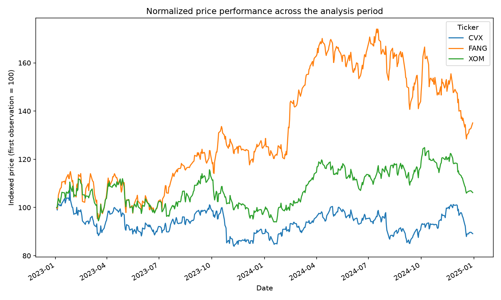
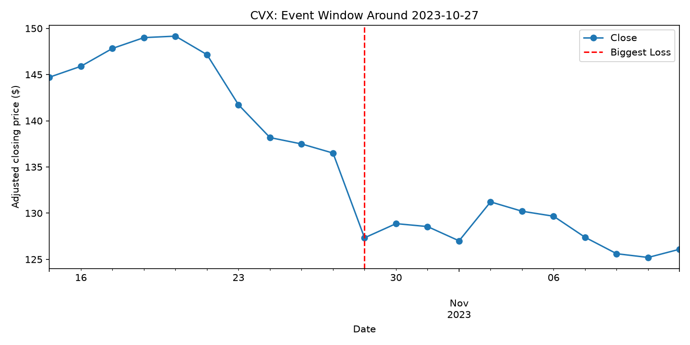
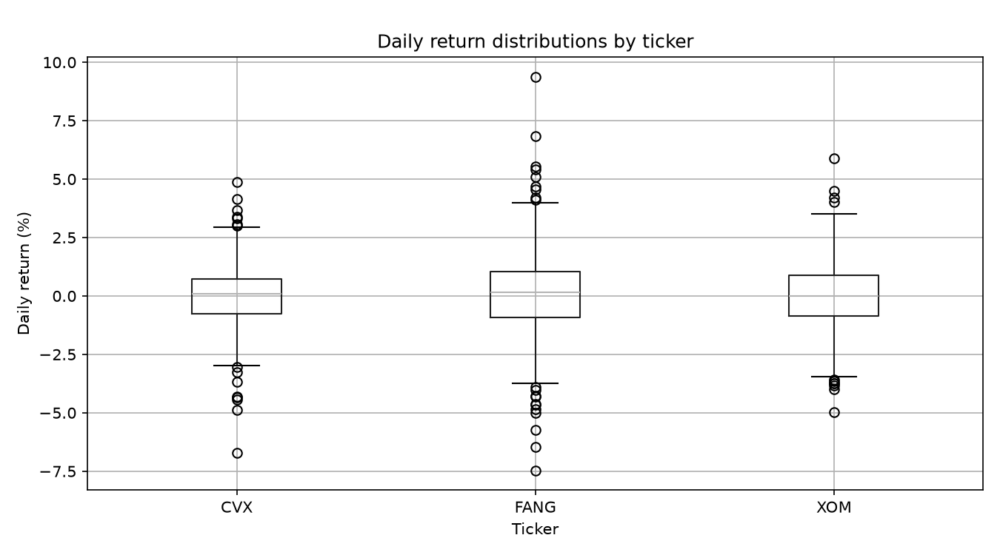
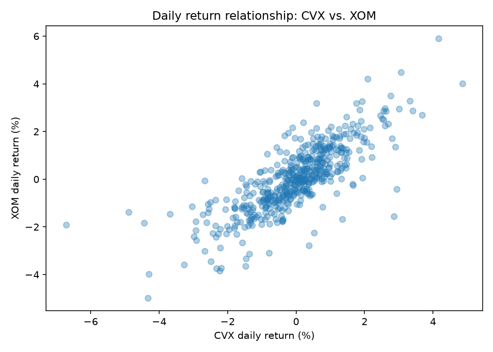

# Stock-Analysis

## Group Members
- Brandon Stuart
- Dennis
- Troy

## Tickers
- CVX (Chevron Corporation)
- XOM (Exxon Mobil Corporation)
- FANG (Diamondback Energy)

## Date Range
2023-01-01 to 2024-12-31 (same range for all tickers)

## Business Questions
Between 2023 and 2024, how did integrated oil majors CVX and XOM differ from upstream shale producer FANG in terms of earnings performance, strategic pivots, and their responses to shared industry trends?

## Why We Chose These Companies
All three are U.S. oil and gas producers exposed to the same crude oil price trend. CVX and XOM are integrated supermajors with refining and chemicals businesses, while FANG is a pure-play Permian shale producer. This lets us compare how diversified majors and a focused upstream company respond to the same oil price moves.

## Requirements
pip install -r requirements.txt
python stock_analysis.py

## Visualization Tools Used & Brief Explanation
Native Pandas/Matplotlib 
(1)Normalized Price Comparison 

*Comparison of growth from beginning of 2023 to end of 2024: FANG experienced the most growth, CVX ending below starting price, with XOM experiencing minimal growth.*

(2)Significant Movement Period (CVX)

*Showcases biggest drop in CVX, due to Q3 performance falling shorter than projected*

(3)Daily Return Distribution

*FANG reacts strongest towads fluctuations in oil prices due to being a smaller shale producer, CVX and XOM are gradual thanks to their diversification and size* 

(4)Relation between two stocks (CVX and XOM)

*Postive upward slope across, correlating towards Finding 3* 

## Significant Movements with Dates
CVX - October 27TH, 2023 : NEGATIVE MOVEMENT

XOM - APRIL 3RD, 2023 : POSITIVE MOVEMENT

FANG - February 13TH, 2024 : POSITIVE MOVEMENT 

*Interesting observation March 15TH, 2023 for the FANG and XOM both experienced negative movement* 

## Researched Explanations with Sources
CVX: With CVX Q3 earnings falling shorter than analyst predictions due to lowered upstream realizations and margins on refined product sales despite higher oil prices. This display made it challenging for investors justify investing in CVX. Further announcements of accquisitions of Hess Corp, PDC energy, and a majority stake in ACES Delta, further contributed towards such discernment.  

XOM: Implementation of oil production cuts by OPEC+ and non-OPEC+ countries aimed at market stabilization.This interplays the perspective of greater oil scarcity which places the valuation of oil to be greater. XOM benefits as it greater valuation leads to greater value in their production operations. In turn this grants positive investor behavior as this leads towards future profitability. 

FANG: Merger announcement between Diamondback Energy, Inc and Endeavor Energy Resources, L.P. This merger projects approximately $550 million in annual synergies and 10% free cash flow per share by 2025. This is further projected by talks of high synergies, combined industry depth, and improved capital allocation. In this confidence, causes investors to react positively towards the merger. 

## Short Summary of Findings
Finding 1: All three stocks have positive average daily returns, but their performance differs.
During 2023–2024, FANG had the highest average daily return at 0.08%; XOM at 0.02%; and CVX at -0.01%. This indicates that FANG performed relatively well in terms of average daily returns during this sample period, while CVX's average daily return was slightly negative. However, average daily return does not equal cumulative return over the entire period.

Finding 2: FANG has the greatest daily return volatility.
FANG has the highest standard deviation at 1.80%, higher than CVX's 1.33% and XOM's 1.40%. Furthermore, FANG's maximum single-day return was 9.38%, and its minimum single-day return was -7.46%. This indicates that FANG's daily returns were more volatile during the sample period, and investors need to pay attention to the trade-off between potential returns and risks.

Finding 3: CVX and XOM show the strongest correlation in daily returns.
The correlation coefficients of the daily returns of the three stocks are as follows:
(1) CVX vs. XOM: 0.7907
(2) FANG vs. XOM: 0.7126
(3) CVX vs. FANG: 0.6663
All correlation coefficients are positive, indicating that the daily returns of the three stocks show a certain degree of co-movement during the sample period. CVX and XOM have the highest correlation, while CVX and FANG have the lowest. This means that holding both CVX and XOM simultaneously may not provide the same level of diversification as holding a portfolio with lower correlation. However, correlation itself does not guarantee future performance, nor does it directly prove that a particular portfolio will necessarily reduce risk.

Finding 4: Significant differences exist in the price levels and volatility of the three stocks.
From the descriptive statistics of closing prices:
(1) The average closing price of CVX is 139.6315, with a standard deviation of 6.6508.
(2) FANG's average closing price was 150.9948, with a standard deviation of 26.1660.
(3) XOM's average closing price was 101.6473, with a standard deviation of 6.9290.
FANG's closing price standard deviation is significantly higher than the other two stocks, indicating greater absolute volatility in its price level during the sample period. However, stock price standard deviation is affected by price levels; therefore, the daily return standard deviation is more relevant when comparing investment risks.

## Links or Citations for External Explanations
See business_sources.md

## Limitations
Limitation 1: Analysis covers only two years of historical data
This study uses data from January 2023 to December 2024; therefore, the conclusions are primarily applicable to this specific period. Stock performance may be influenced by the market environment at the time and cannot be directly inferred from future performance.

Limitation 2: Correlation does not imply causation
Although the daily returns of the three stocks are positively correlated, this does not mean that a change in the price of one stock will directly cause a change in the price of another. Shared market factors or energy sector factors may also affect their returns.

Limitation 3: Cumulative returns have not been directly calculated
Although average daily returns have been compared, average daily returns do not directly reflect the total investment return over the two-year period. Cumulative returns can be calculated later to further compare the actual performance of the three stocks throughout the entire sample period.